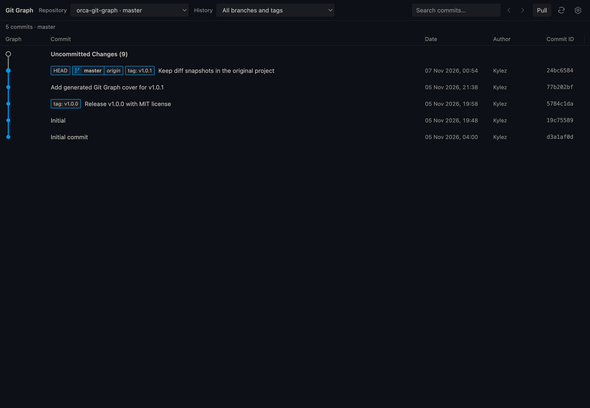
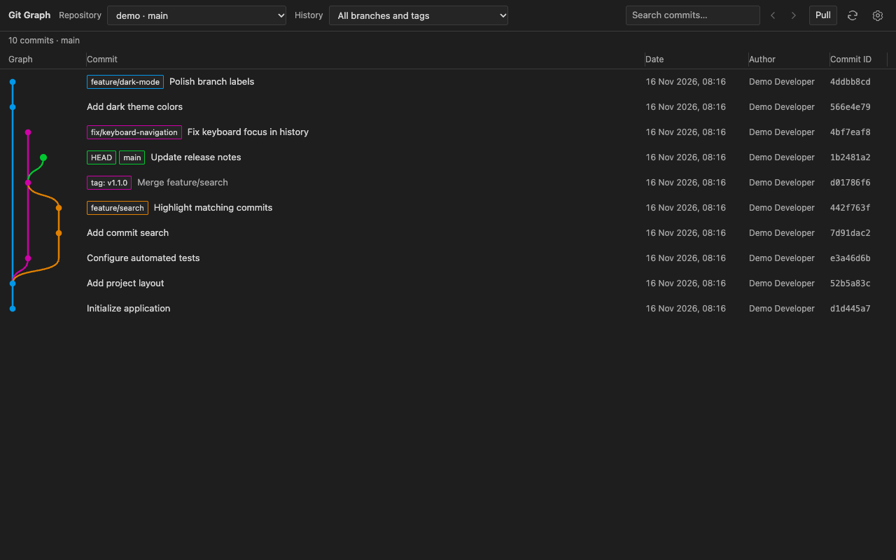

# Git Graph for Orca

View local Git history and file changes in Orca’s sidebar.

Requires Orca 1.4.248+ and Git.

## Use

1. Download or clone this repository.
2. Run `orca plugin dev load . --json` from its folder.
3. Review and approve the plugin in Orca.
4. Open a local repository and select the Git Graph icon in the right sidebar.

Search commits, select a commit to review files, or right-click for Git actions. Settings are beside Refresh and save automatically. Git Graph preferences are shared across all repositories; Git identity and remotes remain repository-local. Compact layout and Show stashes are enabled by default. Older per-repository preferences are no longer used; the shared configuration starts with these defaults.

## UI preview

Captured from the installed v1.0.1 plugin in Orca, using this repository’s history.

The current panel rendered in the browser test harness with a temporary demo repository: four branches, a merge, and a release tag.

## Notes

- Right-click **Uncommitted Changes** to stash changes (including untracked files), reset tracked changes to HEAD, or clean non-ignored untracked files. Reset and Clean permanently discard work and require confirmation.
- Context-menu changes require confirmation. Checkout detaches HEAD; Rebase, Drop, and Reset rewrite history.
- File diffs open as cached snapshots in `.orca/git-graph-diffs/` inside the original project. The plugin adds a local Git exclusion in `info/exclude`, without changing `.gitignore`. Click the file again to refresh, or select **Settings → Open file diffs in → Inline**.
- Cached patches may contain sensitive content and remain until deleted. Close diff tabs before clearing the project’s `.orca/git-graph-diffs/` folder. Older snapshots in `Orca/Git Graph Diffs` in your operating system’s cache directory are not moved or deleted.
- The plugin runs with your account’s access. Use trusted repositories. Windows and Linux have not been verified.

## License

MIT. See [LICENSE](LICENSE).
