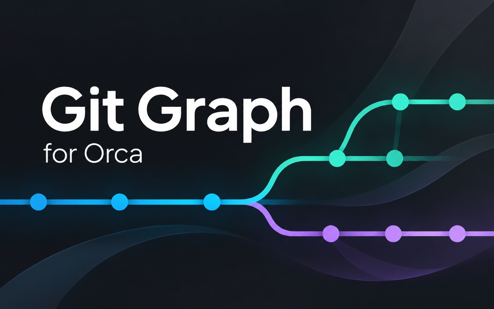

# Git Graph for Orca

View local Git history and file changes in Orca’s sidebar.

Requires Orca 1.4.248+ and Git.

## Use

1. Download or clone this repository.
2. Run `orca plugin dev load . --json` from its folder.
3. Review and approve the plugin in Orca.
4. Open a local repository and select the Git Graph icon in the right sidebar.

Search commits, select a commit to review files, or right-click for Git actions. Settings are beside Refresh and save automatically.

## Notes

- Context-menu changes require confirmation. Checkout detaches HEAD; Rebase, Drop, and Reset rewrite history.
- File diffs open as cached snapshots in `.orca/git-graph-diffs/` inside the original project. The plugin adds a local Git exclusion in `info/exclude`, without changing `.gitignore`. Click the file again to refresh, or select **Settings → Open file diffs in → Inline**.
- Cached patches may contain sensitive content and remain until deleted. Close diff tabs before clearing the project’s `.orca/git-graph-diffs/` folder. Older snapshots in `Orca/Git Graph Diffs` in your operating system’s cache directory are not moved or deleted.
- The plugin runs with your account’s access. Use trusted repositories. Windows and Linux have not been verified.

## License

MIT. See [LICENSE](LICENSE).
